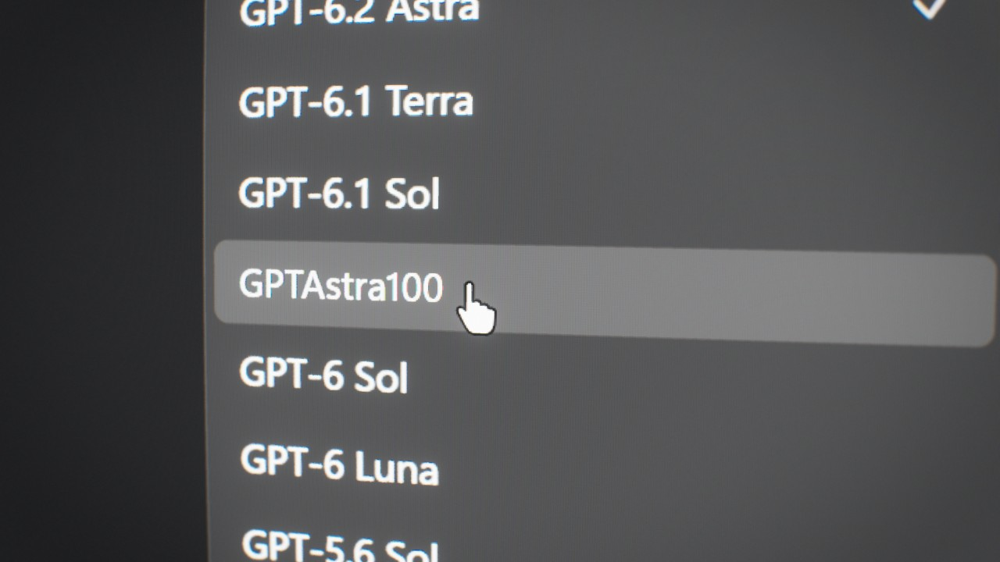
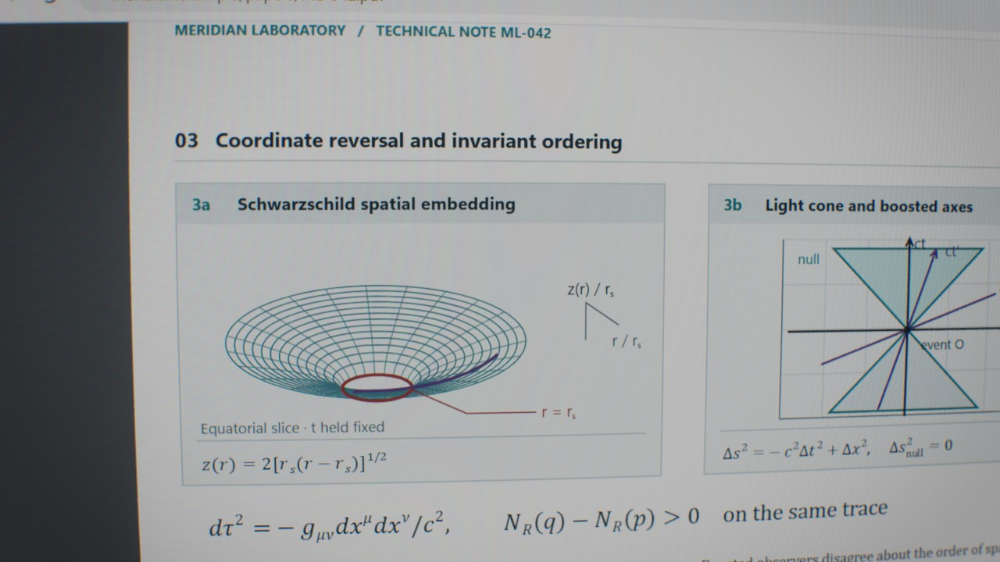

# GPTAstra100 · 时间回执

一部 **3 分 30 秒**的伪纪录片短片。凌晨三点，ChatGPT Work 的模型列表里出现一个叫 GPTAstra100 的模型。有人把推理强度拖到 Ultra 2×，问它「Astra100 大人，请帮我找到逆转时间的公式😭」。检索窗口里，有一份来自这台电脑、却盖着明天日期的回执。

[下载 4K 成片](https://github.com/xiajiadi/gptastra100-time-reversal/releases/latest) · [分镜脚本](docs/storyboard.md) · [倒影素材提示词](docs/reflection-prompt.md)



成片规格为 **3840 × 2160、30 fps、H.264 + AAC 立体声**，共 6,300 帧。片中对话全部出现在电脑画面里，声音由代码合成。片尾停在黑屏倒影。

> 独立制作的虚构短片。GPTAstra100、故事中的论文和回执，以及最终的逆转公式属于剧情设定。ChatGPT 界面及标识来自实际截图和录屏素材。该项目未获 OpenAI 背书。

## 自己渲染一遍

### 环境

- Windows 10 或 11、Microsoft Edge、支持 WebGL2 的 GPU。
- Python 3.11 或更新版本。PyAV 用于无重编码地合并视频分段和连续音轨。已验证的版本见 [requirements.txt](requirements.txt)。
- 至少约 1 GB 可用磁盘空间。分段、音轨和成片都保存在 `out/`。

### 一键出片

在仓库根目录打开 PowerShell，先建立独立 Python 环境。

```powershell
python -m venv .venv
.\.venv\Scripts\python.exe -m pip install -r requirements.txt
powershell -NoProfile -ExecutionPolicy Bypass -File .\make-video.ps1 -Python .\.venv\Scripts\python.exe
```

脚本启动本地预览服务，合成 WAV，调用 Windows AAC 编码，再用无头 Edge 渲染七段画面。最后将分段与同一条音轨封装成 `out/GPTAstra100_3840x2160.mp4`。每段都按全片时间轴绘制，合并时检查帧数、编码配置和时间戳。

先做一版 1080p 预览，或更换端口。

```powershell
powershell -NoProfile -ExecutionPolicy Bypass -File .\make-video.ps1 -W 1920 -Port 8777 -Python .\.venv\Scripts\python.exe
```

字体使用 Windows 界面字体及中文回退字体，公式用 Cambria Math，部分纸面文字使用随仓库附带的 Noto Serif SC。显卡、系统字体和编码器实现会影响像素与压缩结果。

## 预览、截图与单段渲染

先在一个 PowerShell 窗口启动服务。服务监听本机，截图和缓存写入 `out/`。

```powershell
powershell -NoProfile -ExecutionPolicy Bypass -File .\tools\server.ps1
```

在浏览器打开 `http://localhost:8766/`。一键渲染生成音轨后，空格可播放或暂停，左右方向键每次跳过五秒。以下时间点均按**成片时间**计。

| 参数 | 用途 |
| --- | --- |
| `index.html?w=1920&shots=20.3,64.4,187.5&scale=.5` | 截取虚拟手机拍到的画面 |
| `index.html?w=1920&sheet=20.3,64.4,78.8,187.5&cols=2` | 生成关键帧接触表 |
| `index.html?screen=187.5&scale=.5` | 导出拍屏前的显示器画布 |
| `index.html?w=1920&compare=20.3,64.4,187.5` | 生成屏幕原画与虚拟拍屏对照图 |
| `index.html?audio=1` | 单独生成 `out/audio.wav` |

无头截图和渲染片段示例。

```powershell
powershell -NoProfile -ExecutionPolicy Bypass -File .\tools\run-page.ps1 -Path 'index.html?w=1920&shots=64.4&scale=.5' -Done 'SHOTS DONE'
powershell -NoProfile -ExecutionPolicy Bypass -File .\tools\render.ps1 -W 1920 -From 57 -To 81 -Out 'out/research.mp4' -NoAudio
```

## 制作拆解



1. **时间轴**。模型选择、拖动、拼音输入、弹出的窗口、对话出字、相机焦点和音效各自绑定到同一时间轴。中段拉长 10.65 秒，让实验、失败和再推导都有停留时间。
2. **屏幕画布**。首页、模型菜单、Ultra 面板和对话页使用截图底图。胶囊拖动从录屏逐帧取样，权限警告来自同一录屏。在 Canvas 上合成虚构模型名称、提问、工具输出、光标与花屏。
3. **研究窗口与公式**。浏览器窗口内的图版由 Canvas 绘制。镜头经过施瓦西空间嵌入曲面、洛伦兹光锥和布洛赫球，随后在回波热图、奇异值谱和因果分支图上停留。公式以轻量 TeX 排版，保留分数、上下标和算符。
4. **虚拟拍屏**。WebGL2 模拟屏幕子像素、手持运动、卷帘快门、失焦、自动曝光、色差、噪点和倒影。纸面和桌面构图都在显示器画布上，经过同一台虚拟摄像机。
5. **声音与封装**。钢琴、风扇、键盘、时钟和呼吸用代码合成。结尾回放倒置的钢琴主题。Edge 的 WebCodecs 编码 H.264，片段写入 MP4 后由 PyAV 合并。

## 文件结构

| 路径 | 内容 |
| --- | --- |
| `make-video.ps1` | 全片渲染入口 |
| `index.html`、`js/main.js` | 预览、截帧和离线编码 |
| `js/story.js`、`js/revision-story.js` | 剧情、对话、操作事件和机位 |
| `js/footage-plates.js`、`js/chatgpt.js` | 截图合成和对话绘制 |
| `js/browser.js`、`js/revision-plots.js`、`js/mathtex.js` | 论文窗口、实验图和公式 |
| `js/screen.js`、`js/camera.js` | 显示器合成与手机相机模拟 |
| `js/audio.js`、`js/revision-audio.js` | 原创配乐、环境声和节奏拉伸 |
| `js/mp4.js`、`tools/mux.py` | 片段封装和成片合并 |
| `tools/` | 本地服务、GPU 检查与导出 |
| `assets/` | 截图底图、录屏裁切、图标和黑屏倒影 |
| `fonts/`、`docs/` | 字体、分镜、提示词和成片截图 |

## 来源和许可

虚拟拍屏、时间表、音频与编码流程改编自 [naichashu66/opus50-entropy](https://github.com/naichashu66/opus50-entropy)，保留上游 [MIT 许可](LICENSE)。Noto Serif SC 使用 [SIL Open Font License 1.1](fonts/OFL.txt)。ChatGPT 界面截图、录屏衍生素材和标识按其原有权利归属使用，软件许可不授予这些素材或商标的再分发权利。
