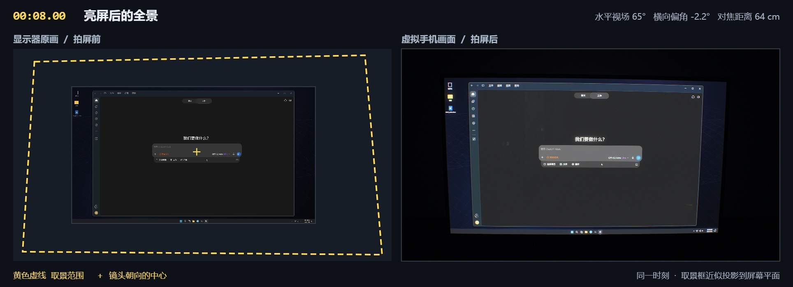
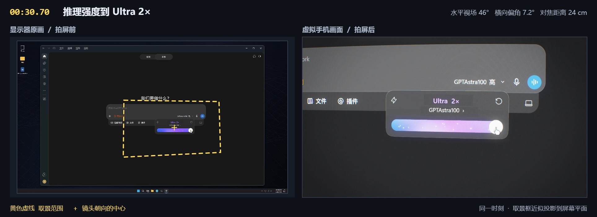
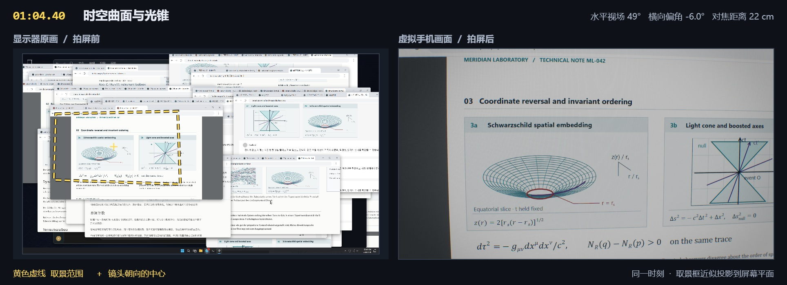
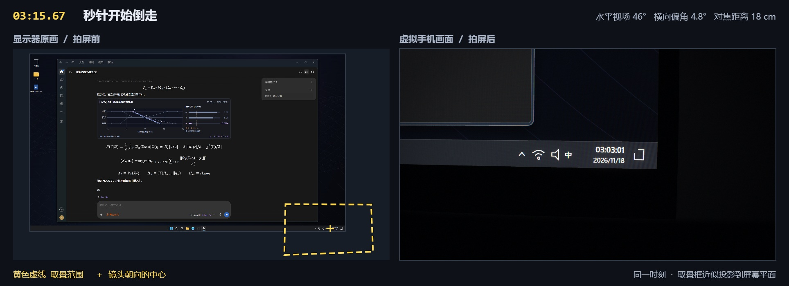

# GPTAstra100 · 时间回执

凌晨三点，ChatGPT Work 的模型菜单里出现了 GPTAstra100。有人把推理强度拖到 Ultra 2×，问它「Astra100 大人，请帮我找到逆转时间的公式😭」。第一条回执来自这台电脑，落款却是明天。

**3 分 30 秒 · 4K UHD · 30 fps · H.264 + AAC 立体声**

[下载 4K 成片](https://github.com/xiajiadi/gptastra100-time-reversal/releases/tag/v1.0.0) · [复现渲染](#在-windows-上渲染) · [完整分镜](docs/storyboard.md) · [倒影素材提示词](docs/reflection-prompt.md)


> 独立制作的虚构短片。GPTAstra100、片中的实验、回执和逆转推导均为剧情设定。界面使用 ChatGPT 截图与录屏素材，项目未获 OpenAI 背书。

## 四个镜头是怎么拍出来的

每组左侧是显示器原画，右侧是虚拟手机在**同一个时刻**拍到的画面。**黄色虚线**是将镜头视野投到屏幕平面上得到的近似取景框，**十字**是镜头指向的位置。框超出屏幕时，右图还能看到显示器边框或周围的黑暗空间。点图可看大图。

| 00:08.00 · 亮屏后的全景 | 00:30.70 · 推理强度到 Ultra 2× |
| --- | --- |
| [](docs/breakdown/shot-01.jpg) | [](docs/breakdown/shot-02.jpg) |
| 镜头离显示器较远，视野带进了屏幕边框和暗室。用这一镜交代拍摄位置。 | 镜头从右侧贴近模型控件。拖动取自录屏，虚构模型名和 2× 标签在屏幕画布上合成。 |
| **01:04.40 · 时空曲面与光锥** | **03:15.67 · 秒针开始倒走** |
| [](docs/breakdown/shot-03.jpg) | [](docs/breakdown/shot-04.jpg) |
| 浏览器窗口仍叠在后台。镜头对焦在论文的施瓦西空间曲面和洛伦兹光锥上，让图注和公式进入特写。 | 镜头压到屏幕右下角。任务栏时钟先按正常速度走，再从 03:03:02 向下计数。 |

大图右上角的**水平视场**是镜头左右能容纳的角度，**横向偏角**是镜头相对屏幕正前方的朝向，**对焦距离**是虚拟相机的焦点设置。这些数据和虚线都由该帧的相机参数计算。

## 从剧本到 MP4

1. **用时间轴排练每一个动作。** [`story.js`](js/story.js) 和 [`revision-story.js`](js/revision-story.js) 记录点击、中文输入法、窗口叠放、对话出字和机位。主片以 30 fps 采样。中段的沙盒推演比原逻辑时间多 10.65 秒，声音按同一映射拉伸，给观众留出看图和读公式的时间。
2. **先生成显示器上的 4K 像素。** [`footage-plates.js`](js/footage-plates.js) 将首页、模型菜单、录屏裁切的胶囊拖动和权限警告铺到 Canvas 上。[`chatgpt.js`](js/chatgpt.js) 补上虚构模型名、提问和工具输出，[`screen.js`](js/screen.js) 绘制桌面、时钟和故障效果。
3. **用可重复计算的图版推进情节。** [`browser.js`](js/browser.js) 预渲染论文窗口，包含布洛赫球、相空间及回波曲线。之后画面从量子回波成功切到记录仪仍在前进，再借奇异值谱筛掉 98 条候选历史。[`revision-plots.js`](js/revision-plots.js) 画出实验结果，[`mathtex.js`](js/mathtex.js) 排版片中的分式、上下标和算符。
4. **把画布放进虚拟房间，用手机重新拍一遍。** [`camera.js`](js/camera.js) 把画布当作显示器纹理，计算透视、屏幕子像素与相机采样叠出来的摩尔纹，以及自动曝光、失焦、卷帘快门和暗部噪点。首尾倒影使用同一张生成图的两个构图。
5. **配乐、成像和封装分开做。** 钢琴、时钟、键盘、风扇与呼吸使用代码合成。Edge 把七段画面编码成 H.264，Windows 编码 AAC 音轨，[`tools/mux.py`](tools/mux.py) 按连续时间戳把它们合并为 MP4。

## 下载与合并 4K 成片

从 [Release v1.0.0](https://github.com/xiajiadi/gptastra100-time-reversal/releases/tag/v1.0.0) 下载 `GPTAstra100_4K.mp4.part01` 至 `part08` 与 `SHA256.json`，都放在项目根目录的 `download/` 文件夹。仓库可通过 Git 克隆，或从 GitHub 的 **Code → Download ZIP** 下载并解压。

```powershell
python .\tools\join-release.py .\download
```

脚本会核对每个分卷和合并后文件的 SHA-256。合并约 337 MB 的二进制文件后，得到 `download/GPTAstra100_4K.mp4`，可直接播放。这个步骤只用 Python 标准库。

## 在 Windows 上渲染

准备 **Windows 10 或 11、Microsoft Edge、支持 WebGL2 的 GPU、Python 3.11 或更新版本**，建议预留至少 1 GB 磁盘空间。Windows 负责 AAC 编码，PyAV 仅用于合并成片。下载源代码后，在项目根目录打开 PowerShell。

```powershell
python -m venv .venv
.\.venv\Scripts\python.exe -m pip install -r requirements.txt
powershell -NoProfile -ExecutionPolicy Bypass -File .\make-video.ps1 -Python .\.venv\Scripts\python.exe
```

默认输出 `out/GPTAstra100_3840x2160.mp4`。加入 **`-W 1920`** 可生成 1080p 版本，端口冲突时加入 **`-Port 8777`**。已在 Windows 上从头生成并解码验证 1080p 版的 6,300 帧和双声道音轨。不同显卡、编码器和 Windows 字体回退可能让画面像素与文件大小略有差异。

### 只看预览、截帧或生成拆解图

在一个 PowerShell 窗口启动本地服务，然后用 Edge 打开 `http://localhost:8766/`。有 `out/audio.wav` 后可用空格播放或暂停，左右方向键各跳五秒。

```powershell
powershell -NoProfile -ExecutionPolicy Bypass -File .\tools\server.ps1
```

把下表参数加到 `http://localhost:8766/index.html` 后面。时刻均以**成片秒数**计，结果保存在 `out/shots/`。

| 参数 | 输出 |
| --- | --- |
| `?w=3840&compare=8,30.7,64.4,195.6666666667&split=1&name=shot` | 四张带投影取景框的对比图。省略 `split` 可输出一张纵向长图。 |
| `?w=1920&shots=30.7,64.4&scale=.5` | 虚拟手机拍屏的两张关键帧。 |
| `?screen=64.4&scale=.5` | 同一时刻的显示器原画。 |
| `?w=1920&sheet=8,30.7,64.4,195.67&cols=2` | 四个时刻的拍屏缩略图。 |

可用 `notes` 为拆解图加标题，各标题之间用 `|` 分隔。在另一个 PowerShell 窗口也可让 Edge 只渲染检索段。

```powershell
powershell -NoProfile -ExecutionPolicy Bypass -File .\tools\render.ps1 -W 1920 -From 57 -To 81 -Out 'out/research.mp4' -NoAudio
```

## 从哪里开始改

| 想改的内容 | 文件 |
| --- | --- |
| 模型出现的时机、对话、镜头走位 | [`js/story.js`](js/story.js)、[`js/revision-story.js`](js/revision-story.js) |
| 界面、胶囊条、资料窗口与图版 | [`js/footage-plates.js`](js/footage-plates.js)、[`assets/`](assets/)、[`js/browser.js`](js/browser.js)、[`js/revision-plots.js`](js/revision-plots.js) |
| 拍屏角度、噪点、失焦、工作流 | [`js/camera.js`](js/camera.js)、[`js/main.js`](js/main.js)、[`make-video.ps1`](make-video.ps1) |
| 音乐、环境声与中段拉伸 | [`js/audio.js`](js/audio.js)、[`js/revision-audio.js`](js/revision-audio.js) |
| 故事节奏和倒影构图 | [分镜脚本](docs/storyboard.md)、[生图提示词](docs/reflection-prompt.md) |

虚拟拍屏、时间轴、合成音频和编码流程改编自 [naichashu66/opus50-entropy](https://github.com/naichashu66/opus50-entropy)，保留上游 [MIT 许可](LICENSE)。Noto Serif SC 使用 [SIL Open Font License 1.1](fonts/OFL.txt)。ChatGPT 截图、录屏衍生素材与商标遵循各自的权利归属。
